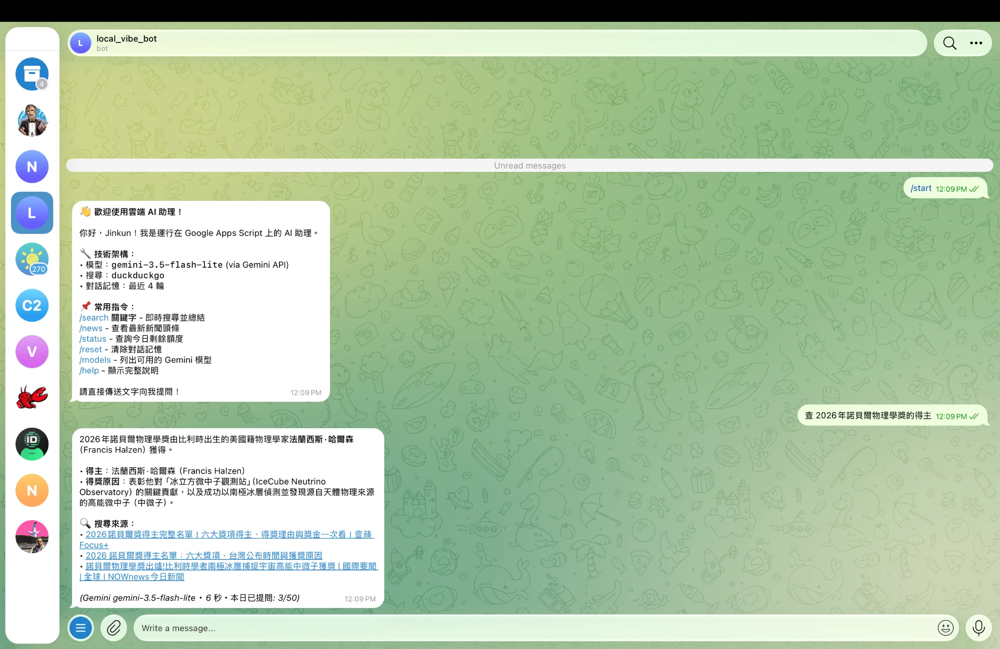
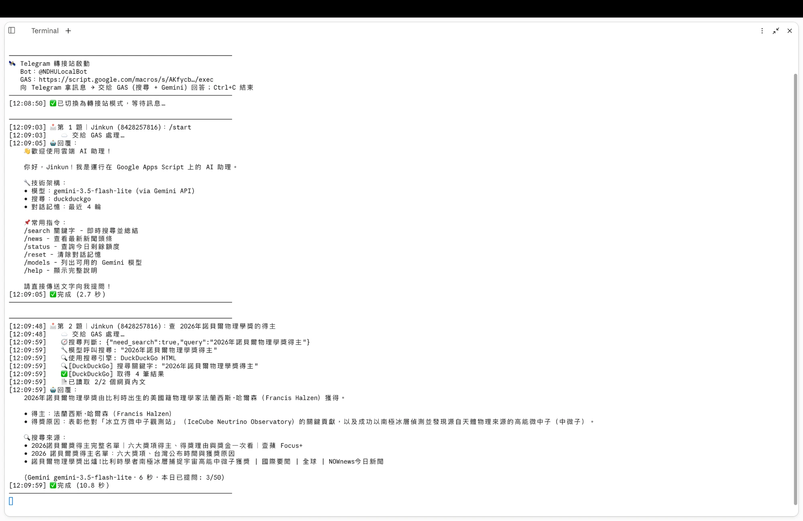

# ☁️ Telegram AI Bot — Google Apps Script + 轉接站

Telegram 聊天機器人：**電腦上的轉接站**向 Telegram 拿訊息、印出每一題，交給 **Google Apps Script (GAS)** 上網搜尋並呼叫 **Gemini** 回答，回覆附上搜尋來源。
由 W6 的 Python + Ollama 本機版 ([chinkunlim/wk06_local_bot](https://github.com/chinkunlim/wk06_local_bot)) 改寫而來。

| 檔案 | 是什麼 |
|---|---|
| [`Code.gs`](Code.gs) | **Apps Script 程式** (單一檔案，可直接貼進 GAS 編輯器；由 `src/*.js` 合併產生) |
| [`relay/relay.js`](relay/relay.js) | **轉接站程式** (在你的電腦上跑，每一題都印在視窗上) |
| [`appsscript.json`](appsscript.json) | GAS 專案設定 (台北時區、網頁應用程式權限) |
| `src/` | `Code.gs` 的原始碼，依功能分檔 (clasp 推送的是這裡) |
| `test/` | 自動測試 (`npm test`，85 項) |

**文件**：[CHANGELOG](CHANGELOG.md) 版本紀錄・[DECISIONS](DECISIONS.md) 架構決策・[KNOWN_ISSUES](KNOWN_ISSUES.md) 已知問題・[WORKFLOW_GUIDE](WORKFLOW_GUIDE.md) 開發與部署流程・[AGENTS](AGENTS.md) 程式規範

## 🧭 架構

```
 📱 Telegram ◀── getUpdates 長輪詢 ── 💻 轉接站 relay.js (你的電腦，印出每一題)
     ▲                                     │ POST ?action=ask&token=WEBHOOK_SECRET
     │                                     ▼
     └──── 回覆 (含搜尋來源) ──── ☁️ GAS Code.gs：搜尋判斷 → 搜尋 + 讀網頁 → Gemini
                                           │ 把回覆與過程紀錄傳回轉接站印出
```

- **轉接站** (電腦上)：向 Telegram 拿新訊息 (getUpdates)、印出題目、交給 GAS，再印出 GAS 的搜尋過程與回覆。只需要 Telegram Token 與 GAS 網址，**Gemini 金鑰只放在 GAS**
- **GAS** (Google 雲端)：白名單、每日額度、對話記憶 (Google 試算表)、搜尋、讀網頁、呼叫 Gemini、回覆 Telegram
- **為什麼不讓 Telegram 直接 webhook 到 GAS**：GAS 網頁應用程式一律回 `302` 轉址，Telegram 把它當成失敗，重試間隔越拉越長，實測幾則訊息後 bot 就卡住不回。改由轉接站主動拿訊息就沒有這個問題，而且不需要 cloudflared 通道或固定 IP
- **電腦關機時 (GAS 獨立模式)**：轉接站按 `Ctrl+C` 結束時會把 webhook 設回 GAS，由 GAS 自己回答；受上面的 302 問題影響，可能越來越慢甚至卡住。下次開轉接站時，Telegram 保留的未處理訊息 (最多 24 小時) 會被補答

## 📦 怎麼裝

需要：Node.js 20 以上、`curl` (macOS 內建)、Google 帳號、Telegram。

1. **下載與安裝** (套件只裝在專案資料夾，不裝全域)
   ```bash
   git clone https://github.com/chinkunlim/wk07_bot_google.git
   cd wk07_bot_google
   npm install
   npm test
   ```
2. **準備三樣東西**
   - Gemini API key：<https://aistudio.google.com/apikey>
   - Telegram Bot Token：Telegram 找 **@BotFather** → `/newbot`
   - 你的 Telegram User ID：找 **@userinfobot**
3. **建立 GAS 專案**，二選一：
   - **A. 貼上 (最簡單)**：到 <https://script.google.com> 新增專案，把 [`Code.gs`](Code.gs) 整份貼進 `程式碼.gs`；「專案設定」勾選「在編輯器中顯示 appsscript.json」，把 [`appsscript.json`](appsscript.json) 的內容貼進去
   - **B. clasp (用指令推送)**：先到 <https://script.google.com/home/usersettings> 開啟「Google Apps Script API」
     ```bash
     npm run login                            # 登入 Google，憑證存在本資料夾的 .clasprc.json
     cp appsscript.json appsscript.json.bak   # create 會用預設值覆蓋設定檔，先備份
     npm run create                           # 建立 GAS 專案
     mv appsscript.json.bak appsscript.json   # 還原設定檔
     npm run push                             # 推送 src/ 與 appsscript.json
     ```
4. **設定 GAS 指令碼屬性** (金鑰只放這裡，不寫在程式碼裡)
   1. GAS 編輯器執行 `setupProperties` (第一次會要求授權；出現「Google 尚未驗證」點「進階 → 前往」)
   2. 「專案設定 → 指令碼屬性」填 `TELEGRAM_BOT_TOKEN`、`ALLOWED_USER_IDS`、`GEMINI_API_KEY`
   3. 再執行一次 `setupProperties`，看到 `✅ 設定檢查通過`；`checkEnv` 會檢查模型與 Telegram Bot
5. **部署並接上 Telegram**
   1. 「部署 → 新增部署作業 → 網頁應用程式」：執行身分「我」、存取權「**所有人**」
   2. 複製 `/exec` 結尾的網址，填入指令碼屬性 `WEBHOOK_URL`
   3. 執行 `setWebhook` (會自動產生 `WEBHOOK_SECRET`、註冊指令選單)
   4. 瀏覽器開啟 `/exec` 網址，看到 `… is running. relay-v2` 代表部署的是新版

   > 改了程式後：`npm run push`，再「部署 → 管理部署作業 → 編輯 (鉛筆) → 版本：**新版本** → 部署」，網址不變。
   > 部署作業綁定的是「當時的版本」，只 push 不建立新版本，網址跑的還是舊程式。
   > push 之後若有**之前就開著的編輯器分頁**，先重新整理再操作，否則它會把舊程式存回去。
6. **設定轉接站**
   ```bash
   cp .env.example .env
   ```
   在 `.env` 填入與指令碼屬性相同的 `TELEGRAM_BOT_TOKEN`、`WEBHOOK_URL`、`WEBHOOK_SECRET` (`.env` 已被 `.gitignore` 排除，不會上傳)

> 在 GAS 編輯器裡，函式選單只列出**目前開啟的檔案**的函式：用 clasp 推送時 `setupProperties` 在 `src/Config.gs`、`setWebhook` 在 `src/Main.gs`、`checkEnv` / `testSearch` 在 `src/Diagnostics.gs`；用貼上的方式則都在 `程式碼.gs`。

## ▶️ 怎麼跑

```bash
npm run relay
```

視窗會顯示「✅ 已切換為轉接站模式，等待訊息…」。用手機傳訊息給 bot，例如：

- `查 花蓮景點推薦` → 轉接站印出題目、GAS 的搜尋過程與回覆；手機收到回答，最後附「🔍 搜尋來源」
- `/start`、`/help`、`/search 關鍵字`、`/news`、`/status` (今日額度)、`/reset` (清除記憶)、`/models` (可用模型)

轉接站視窗範例：
```
[11:47:06] 📩 第 1 題｜Jinkun (…)：查 花蓮景點推薦
[11:47:06]    ☁️  交給 GAS 處理…
[11:47:09]    🧭 搜尋判斷: {"need_search":true,"query":"花蓮景點推薦"}
[11:47:09]    🔍 [DuckDuckGo] 搜尋關鍵字: "花蓮景點推薦"
[11:47:09]    ✅ [DuckDuckGo] 取得 4 筆結果
[11:47:09]    📄 已讀取 2/2 個網頁內文
[11:47:21] 🤖 回覆：
    花蓮擁有壯麗的山海景觀…
    🔍 搜尋來源：
    • 2026【花蓮景點】推薦放假出遊好地點…
[11:47:21] ✅ 完成 (14.7 秒)
```

`Ctrl+C` 結束轉接站後，webhook 會設回 GAS (GAS 獨立模式)。

其他執行方式：

| 指令 | 用途 |
|---|---|
| `npm run simulate` | 不接 Telegram，在終端機直接打字問 bot (只需要 `GEMINI_API_KEY`) |
| `npm test` | 自動測試 (不連網、不需金鑰) |
| `npm run build` | 修改 `src/` 後重新產生 `Code.gs` |
| `npm run push` | 用 clasp 把 `src/` 推到 GAS (之後要「部署 → 管理部署作業 → 新版本」才會生效) |
| `npm run redeploy -- <deploymentId>` | 把既有部署更新到新版本 (網址不變；ID 用 `npm run deployments` 查) |

## ✏️ 我改了什麼

和 W6 的 Python + Ollama 本機版相比：

| | W6 本機版 | W7 這個版本 |
|---|---|---|
| 收訊息 | 電腦用 long polling 向 Telegram 拉訊息 | **轉接站**向 Telegram 拉訊息，交給 **GAS** 回答 |
| 模型 | 本機 Ollama (llama3.1) | **Gemini API** (`gemini-3.5-flash-lite`)；額度用完 (429) 自動改用備援模型 |
| 電腦關機時 | bot 停擺 | webhook 設回 GAS，**GAS 獨立回答** (可能變慢)；開機後補答未處理的訊息 |
| 搜尋 | DuckDuckGo、Google News、ddgs 備援 | DuckDuckGo、Google News、**multi 備援** (Bing → DuckDuckGo Lite → Mojeek)，搜尋後讀前 2 筆網頁內文 |
| 資料 | 本機 JSON 檔 | **Google 試算表** (對話、配額、日誌) |
| 設定與金鑰 | `.env` | GAS **指令碼屬性**；轉接站 `.env` 只放 Telegram Token 與 GAS 網址 (不進版控) |
| 程式語言 | Python | JavaScript：GAS (V8) + 轉接站 (Node.js，零套件) |
| 測試 | pytest | Node 內建 test runner，85 項 (模擬 GAS 環境，不連網) |

細節：

- **搜尋判斷**：沿用 W6 的 router 模式，先讓模型輸出 JSON `{need_search, query}`，寫程式、翻譯、閒聊不搜尋；也可切換成原生 Function Calling (`SEARCH_DECISION=tools`)
- **Gemini 3 的工具呼叫**：Gemini 3 的工具呼叫帶有模型產生的簽章 (thoughtSignature)，不能像 W6 那樣自己假造一筆工具呼叫，所以 router 模式改成把搜尋結果附在使用者問題後面
- **轉接站模式**：一開始讓 Telegram 直接 webhook 到 GAS，結果因為 GAS 一律回 302，Telegram 越重試越慢、最後不再送訊息；改成轉接站用 getUpdates 主動拿訊息後就穩定了
- **防重複回答**：同一則訊息重送時以 `update_id` 去重
- **安全**：webhook 與轉接站輪詢都要帶 `WEBHOOK_SECRET`，否則拒絕；白名單外的人只會看到自己的 User ID
- **時區**：配額與「今天日期」固定用台北時間

## 🖼️ 執行畫面

同一時刻 (12:09)、同一題「查 2026年諾貝爾物理學獎的得主」：

**Telegram：bot 回答並附搜尋來源**



**電腦：轉接站印出這一題、GAS 的搜尋過程與回覆**



## ⚙️ 指令碼屬性 (設定)

| 屬性 | 預設 | 說明 |
|---|---|---|
| `TELEGRAM_BOT_TOKEN` | (必填) | @BotFather 取得 |
| `ALLOWED_USER_IDS` | (必填) | 白名單，逗號分隔 |
| `GEMINI_API_KEY` | (必填) | Google AI Studio 取得 |
| `GEMINI_MODEL` | `gemini-3.5-flash-lite` | 主模型，`/models` 可查可用模型 |
| `GEMINI_FALLBACK_MODELS` | `gemini-3.1-flash-lite,gemini-3.6-flash` | 主模型額度用完 (429) 或過載 (503) 時依序改用，留空停用；頁尾標示 `(備援)` |
| `GEMINI_RETRIES` | `1` | 最後一個模型回 429 / 5xx 時的重試次數 |
| `GEMINI_MAX_OUTPUT_TOKENS` | `4096` | 回答長度上限 (含思考 token) |
| `SEARCH_DECISION` | `router` | `router`：先判斷要不要搜；`tools`：原生 Function Calling |
| `SEARCH_ENGINE` | `duckduckgo` | `duckduckgo` \| `google_news` \| `multi` |
| `SEARCH_FALLBACK_ENGINE` | `multi` | 主引擎無結果 / 被擋時使用，留空停用 |
| `SEARCH_FETCH_PAGES` | `2` | 讀取前 N 筆網頁內文 (0 = 只用摘要) |
| `SEARCH_PAGE_CHARS` | `2000` | 每頁內文摘錄上限 |
| `SEARCH_MAX_RESULTS` | `4` | 每次搜尋結果數 |
| `MAX_HISTORY_TURNS` | `4` | 對話記憶輪數 |
| `MAX_DAILY_REQUESTS` | `50` | 每人每日提問上限 |
| `SPREADSHEET_ID` | (自動) | 資料試算表，留空時自動建立 |
| `WEBHOOK_URL` | | 網頁應用程式 `/exec` 網址 |
| `WEBHOOK_SECRET` | (自動) | `setWebhook` 產生，驗證 Telegram 與轉接站的請求 |
| `SIM_QUERY` / `SIM_SEARCH` | | 編輯器 `simulate()` / `testSearch()` 用的問題 |

只改指令碼屬性不需重新部署，下一則訊息就生效。轉接站讀 `.env`，修改後重開轉接站。

## 🐛 除錯

| 現象 | 排查 |
|---|---|
| 轉接站顯示「收到網頁而不是 JSON」 | 網頁應用程式存取權不是「所有人」，或部署的不是新版本 (開 `/exec` 網址看有沒有 `relay-v2`)。學校帳號若只能選「網域內使用者」，請改用個人 Gmail |
| 轉接站顯示「token 不符」 | `.env` 的 `WEBHOOK_SECRET` 要和指令碼屬性完全相同 |
| 轉接站顯示 `Conflict` | 有另一個轉接站或 W6 Python 版在跑 (同一個 Token 只能有一個程式拿訊息) |
| 沒開轉接站時 bot 越來越慢、不回 | GAS 獨立模式受 302 影響；開轉接站即可，未處理的訊息會補答 |
| `Gemini API 使用量已達上限` | 主模型與備援模型的免費額度都用完了，可在 `GEMINI_FALLBACK_MODELS` 多加模型 |
| 想看 GAS 自己能不能回答 | GAS 編輯器執行 `simulate` (不經過 Telegram)，看執行紀錄 |
| 偶爾一行 HTTP 404 | 剛重新部署時 Google 還在同步，稍等即可 |

## 🧼 不污染電腦環境

- clasp 裝在專案的 `node_modules`，不用 `npm install -g`；登入憑證存在專案內的 `.clasprc.json`，不寫到家目錄
- `.clasp.json`、`.clasprc.json`、`.env`、`node_modules/` 都在 `.gitignore`
- 要完全移除：刪掉整個資料夾即可
